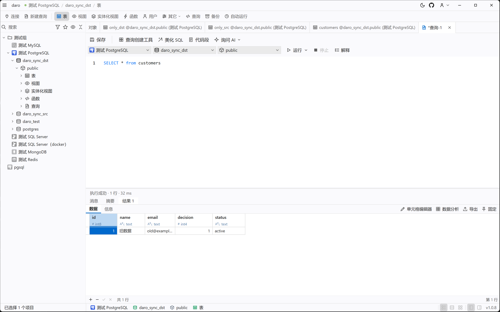
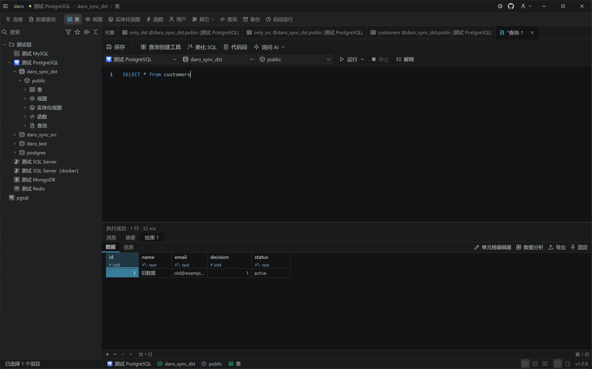
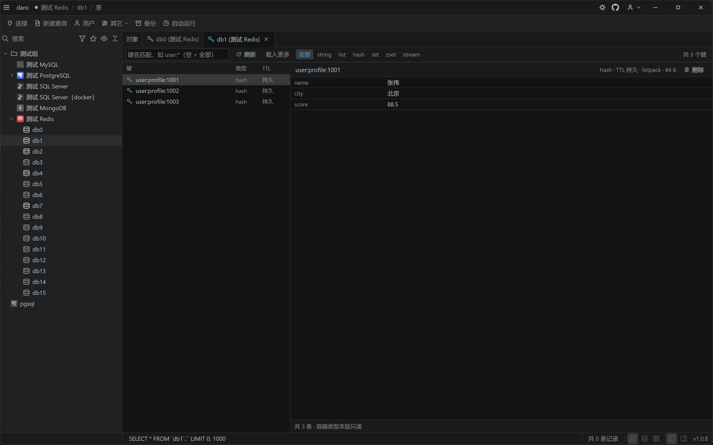
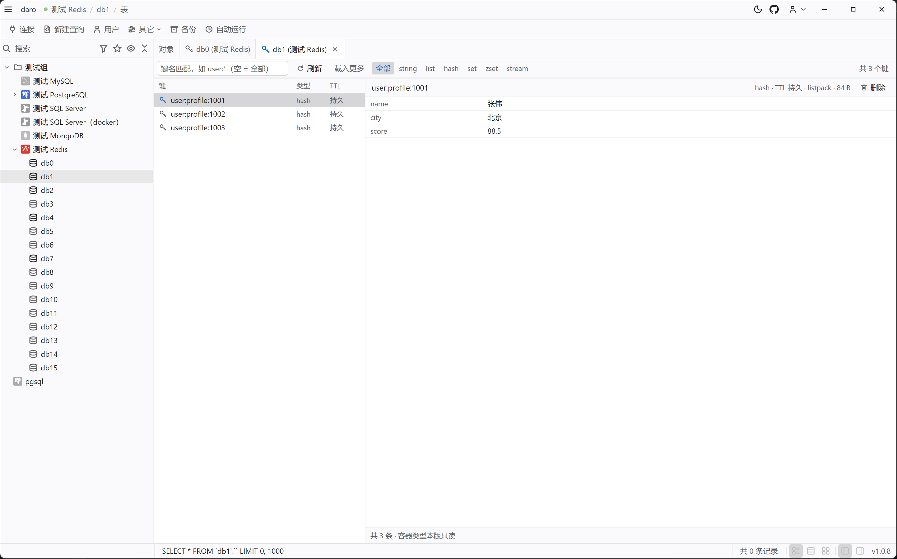

# daro

> **原生、轻量、跨平台的桌面数据库连接与管理工具。**
> 一个工具，连得上你手头所有数据库；不用装一堆驱动，不占内存，开箱即用。

---

## daro 是什么

**daro 是一款对标 Navicat 的轻量级桌面数据库管理工具。** 它把连接管理、表数据浏览/编辑、SQL 查询、表结构设计、数据导入导出这些日常 DBA 与开发工作，收进一个干净的原生桌面应用里。

与常见的 Electron 类工具不同，daro 用 纯 **Rust** 从零重写（代号 `daro-rs`），不依赖浏览器内核，因此启动快、内存占用低、安装包小，还提供免安装的绿色版。

界面与交互对齐参考产品，连接文件（`.ncx`）双向互通，老用户迁移零成本。

---

## 界面预览

**SQL 查询 · 结果网格**（PostgreSQL）

<p align="center">
  
</p>

**多页签查询 · 表数据浏览**

<p align="center">
  
</p>

**Redis 键浏览 · 深色主题**

<p align="center">
  
</p>

**Redis 键浏览 · 浅色主题**

<p align="center">
  
</p>

---

## 为什么选择 daro

- **原生轻量，不为 GUI 付额外代价。** Rust + gpui 原生实现，没有 Electron 的运行时与内存开销；绿色版解压即用，不写注册表、不留垃圾。
- **一个工具管所有数据库。** SQLite / MySQL / PostgreSQL / SQL Server / Redis / MongoDB / Access 统一在一个界面里管理，不用为每种引擎装一套客户端。
- **真正跨平台。** Windows / macOS / Linux 同一套代码、同一套交互，换电脑不断档。
- **兼容 Navicat 和 another redis desktop manager 连接。** 支持导入 / 导出 `.ncx` 连接文件（含分组与私有属性、密码解密），老连接一键带走。
- **本地优先，数据不出本机。** 连接配置、主题、已保存查询全部存在本地，不上云、不追踪。
- **为 AI 时代预留接口。** 内置 `daro-mcpd` MCP 服务，让 Claude / Cursor 等 AI 工具在你的授权下直接查询数据库——把 daro 变成 AI 编程工作流里的数据库入口。

---

## 支持的数据库

| 引擎 | 平台 | 当前状态 |
|---|---|---|
| SQLite | Windows / macOS / Linux | ✅ |
| PostgreSQL | Windows / macOS / Linux | ✅ |
| MySQL / MariaDB | Windows / macOS / Linux | ✅ |
| SQL Server | Windows / macOS / Linux | ✅ |
| Redis | Windows / macOS / Linux | ✅ |
| MongoDB | Windows / macOS / Linux | ✅ |
| Access（`.mdb` / `.accdb`） | 仅 Windows | ✅ |

---

## macOS 打开说明

当前发布的 macOS 包使用 **ad-hoc 临时签名**，未加入 Apple 开发者计划，也未做公证。从浏览器或微信下载解压后双击，会被 Gatekeeper 拦下，弹窗是：

> **"daro-rs" Not Opened** — Apple could not verify "daro-rs" is free of malware that may harm your Mac or compromise your privacy.

弹窗只有「完成」和「移到废纸篓」，没有「仍要打开」。这不是文件损坏，是签名问题。可以用下面的方法放行：

**方法一：系统设置里放行（推荐）**

1. 双击 `daro-rs.app`，弹出上面的提示时点「完成」（不要点「移到废纸篓」）。
2. 打开「系统设置 → 隐私与安全性」，向下滚动到「安全性」，会出现「已阻止"daro-rs"使用，因为它不是来自已识别的开发者」，点右侧「仍要打开」，输入登录密码。
   该按钮只在尝试打开后 1 小时内出现；如果看不到，回访达再双击一次触发拦截，再回设置页等几秒。
3. 再次双击即可启动。系统会记住这次信任，之后直接双击就能打开。

**方法二：终端清除隔离属性**

```bash
xattr -dr com.apple.quarantine /Applications/daro-rs.app
```

然后再双击启动。个别新版 macOS 上此方法可能无效，无效时用方法一。

**方法三：从源码自行构建**

本地构建的可执行文件不带下载隔离属性，不会被拦。在 `daro-rs/` 目录执行 `cargo build --release --bin daro-rs`，然后运行 `target/release/daro-rs`（需已安装 Rust 工具链）。

以上步骤彻底免除需要 Developer ID 正式签名 + 公证（需 Apple 开发者账号）。发布包内附同样的「打开说明.txt」，校验下载完整性可用发布页的 `SHA256SUMS.txt`。

---

## 交流

QQ 交流群：1132083886
